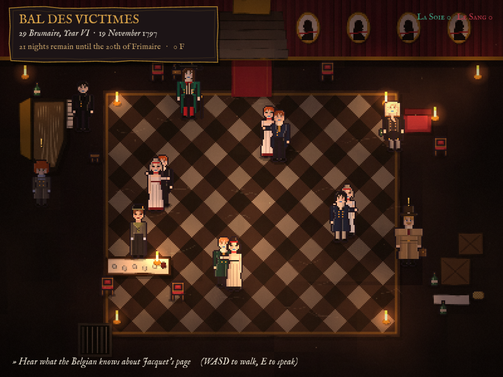
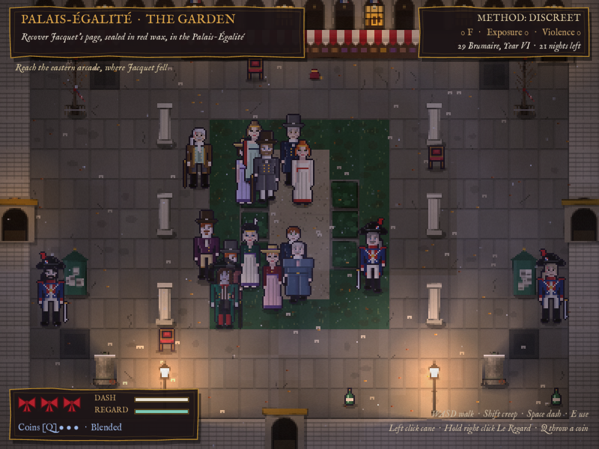
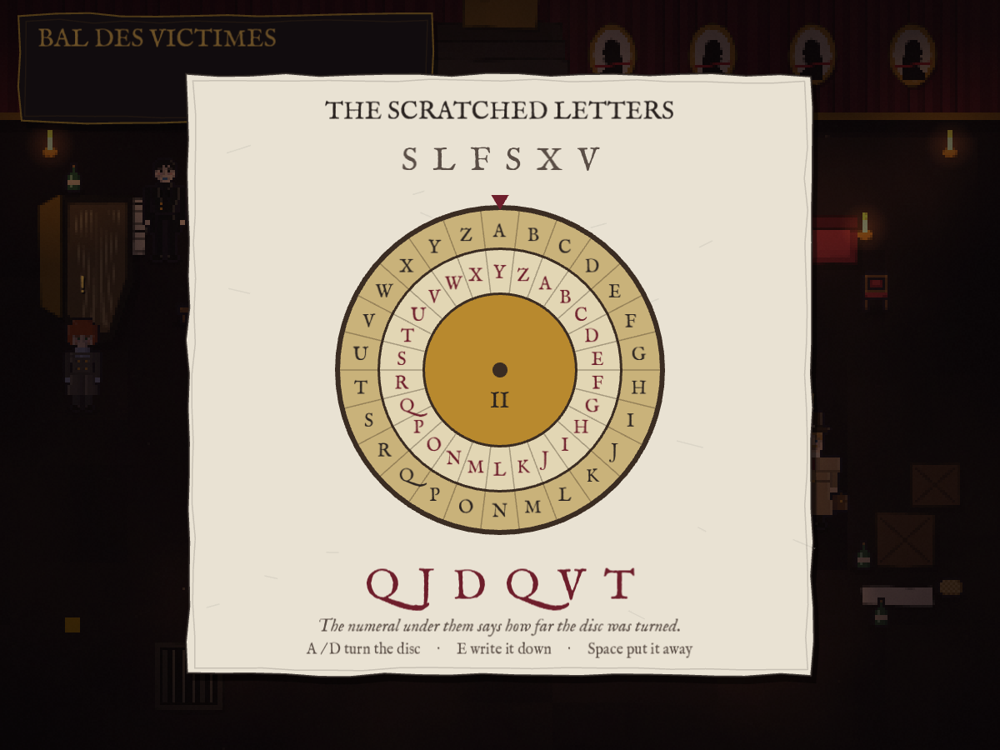

# Le Sang et la Soie

*Blood and Silk.* A stealth game set in Paris, in the winter of 1797.

The Terror is over. In a cellar under the city, the children of the guillotined hold the Bal des Victimes: they dance with a red ribbon tied round the throat and their lips painted the colour of the drowned. Étienne de Vauclaire is one of them, an *Incroyable* in an emerald coat. Twenty-one nights before the 20th of Frimaire, he goes out into a city that has stopped believing in anything to find a page that should not exist.

## What you do

- **Slip through Paris:** the arcades of the Palais-Égalité, the quarries under the Left Bank, the workshops of the Faubourg Saint-Antoine. Guards see, hear and follow you; crowds, shadows and darkness hide you.
- **Choose how:** a lead-tipped cane and a dance step for a dodge, or never being seen at all. Every guard you hurt is remembered.
- **Work things out:** put out a street lamp and wear the dark (someone will come to see who took the light), move a barrel onto a counterweight, read what someone scratched into a pedestal and turn a cipher disc until it means something.
- **Talk:** every conversation pulls Étienne toward silk or toward blood, and the people of the Bal remember which.

## How to play

1. Open **[Releases](../../releases)** and download the latest `.zip`.
2. Unzip it anywhere and run `SangEtSoie.exe`.
3. Windows may warn that the program is from an unknown publisher (it is not signed). Choose *More info*, then *Run anyway*.

Windows 10 or 11, 64-bit. Your progress saves automatically.

### Controls

| | |
|---|---|
| WASD | walk |
| Shift (hold) | creep, silently |
| Space | dash |
| Left click | the cane |
| Right click (hold) | Le Regard: time slows, hidden things show |
| Q | throw a coin, to draw a guard away |
| E | talk, use, read, put out a light |

## Status

Early and in progress: the first two acts are playable. There is no sound yet. Feedback and bug reports are welcome in [Issues](../../issues).

## Credits

Made with [Godot Engine](https://godotengine.org) (MIT licence).

Typeface: IM Fell English by Igino Marini, used under the SIL Open Font License; see `FONT_LICENSE_OFL.txt`.

## Rights

© 2026 rodrigosqrt3. All rights reserved.

You may download and play the game for free. You may not redistribute it, sell it, modify it, or reuse its story, characters, writing or art, in whole or in part, without written permission.

The source code is not public.
