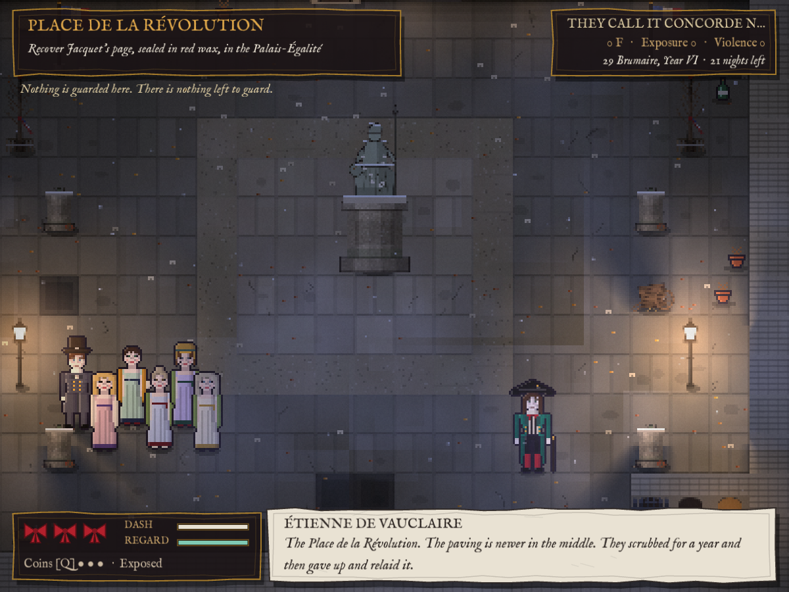

# Le Sang et la Soie

A stealth game set in Paris in the winter of 1797, a few years after the Terror.

After the guillotine stopped, the families of the executed began holding the Bal des Victimes, where you could only get in if someone close to you had died on the scaffold. The guests wore a red ribbon around the neck and danced. Étienne de Vauclaire is one of them, an *Incroyable* in an emerald coat, and he has twenty-one nights to find Jacquet's page before the 20th of Frimaire.

## The game

You go out from the Bal into the city at night: the arcades of the Palais-Égalité, the old quarries under the Left Bank, the workshops of the Faubourg Saint-Antoine. Guards can see and hear you, and the crowd, the shadows and the dark are where you hide.

You carry a cane with a lead tip and you can fight, but the game remembers every guard you hurt. You can also get through without anyone seeing you.

Some things have to be worked out rather than fought. Street lamps can be put out to make a dark place to hide, though a guard will usually come to check why the light went out. There is a strongroom gate held shut by a counterweight, and a message scratched into a pedestal that only makes sense once you find a way to read it.

In conversations, Étienne leans toward silk or toward blood, and the people at the Bal notice which.

## How to play

1. Go to [Releases](../../releases) and download the latest `.zip`.
2. Unzip it and run `SangEtSoie.exe`.
3. Windows will probably warn you that the publisher is unknown, because the game is not signed. Click *More info* and then *Run anyway*.

It runs on 64-bit Windows 10 and 11. The game saves on its own.

### Controls

| Key | Action |
|---|---|
| WASD | Walk |
| Shift (hold) | Creep quietly |
| Space | Dash |
| Left click | Swing the cane |
| Right click (hold) | Le Regard: slows time and shows hidden marks |
| Q | Throw a coin to distract a guard |
| E | Talk, read, use things, put out lights |

## Status

This is an early version. The first two acts can be played from start to finish, and there is no sound yet. If you find a bug, please open an [issue](../../issues).

## Credits

Made with [Godot Engine](https://godotengine.org) (MIT licence).

Font: IM Fell English by Igino Marini, under the SIL Open Font License (see `FONT_LICENSE_OFL.txt`).

## Rights

© 2026 rodrigosqrt3. All rights reserved.

You can download the game and play it for free. You may not redistribute it, sell it, modify it, or reuse its story, characters, writing or art, in whole or in part, without written permission.

The source code is not public.
